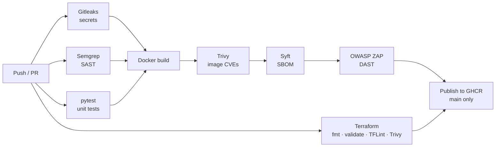

# DevSecOps in 30 Days

[](https://github.com/hulaneoTi/devsecops-30-days/actions/workflows/devsecops.yml)

A hands-on, public learning project: a small Python API shipped through a full DevSecOps pipeline, then deployed to AWS with Terraform and to Kubernetes with Ansible and Helm.

I work as a DevSecOps engineer in IT/OT (industrial) security. This repo is where I practice, in the open, the tools I apply at work: secrets scanning, SAST, container scanning, SBOM, IaC security, DAST, Kubernetes and cloud. Progress is tracked in the roadmap below and in [PROGRESS.md](PROGRESS.md).

## Pipeline



| Stage | Tool | Fails the build on |
| --- | --- | --- |
| Secrets | Gitleaks | Any secret in code or Git history |
| SAST | Semgrep (`p/python`, `p/dockerfile`) | Any finding |
| Unit tests | pytest | Any failing test |
| IaC quality | `terraform fmt/validate`, TFLint | Formatting, syntax or lint errors |
| IaC security | Trivy `config` | HIGH / CRITICAL misconfigurations |
| Image | Trivy `image` | HIGH / CRITICAL CVEs with a fix available |
| SBOM | Syft (SPDX JSON) | Never (artifact only) |
| DAST | OWASP ZAP baseline | Report only, for now ([Week 2](#week-2--full-devsecops-pipeline)) |

Accepted risks are documented, one by one, in [.trivyignore](.trivyignore).

Infrastructure is deployed by a separate, manual workflow ([terraform-deploy.yml](.github/workflows/terraform-deploy.yml)) that uses GitHub OIDC (no AWS keys stored) and requires approval before `apply`. See [terraform/README.md](terraform/README.md).

## Stack

**Already using at work:** Linux, Docker, GitLab CI/CD, Python, Bash, Terraform, LDAP/Keycloak, network security.

**Learning in this repo:** Kubernetes (K3s), Helm, Ansible, AWS, DAST.

## Roadmap

### Week 1 — Foundations

- [ ] Repo, README and progress log published
- [ ] Run Gitleaks, Semgrep and Trivy locally and understand every finding
- [ ] Pin every tool image and GitHub Action to a fixed version (then to a commit SHA)
- [ ] Enable Dependabot alerts and secret scanning in the repo settings

### Week 2 — Full DevSecOps pipeline

- [ ] Pipeline green on `main`
- [ ] Break the build on purpose (fake secret, vulnerable package) and document how each tool caught it
- [ ] Add a ZAP rules file so chosen alerts fail the build
- [ ] Commit `.terraform.lock.hcl` and run TFLint with the AWS ruleset
- [ ] Write down what the pipeline found and how long it takes

### Week 3 — Kubernetes and Ansible

- [ ] Ansible playbook that installs K3s on 2–3 VMs and hardens the nodes
- [ ] Helm chart for the app: probes, resource limits, non-root, read-only filesystem
- [ ] Cluster scan with Trivy (`k8s` mode) and kube-bench (CIS Benchmark)
- [ ] Prometheus + Grafana with 3 real alerts

### Week 4 — AWS and Terraform

- [ ] AWS account with a billing alarm and an OIDC role for GitHub
- [ ] Deploy the sandbox with the manual workflow, then destroy it
- [ ] Add an S3 bucket with encryption, versioning and public access blocked
- [ ] VPC flow logs
- [ ] HashiCorp Terraform Associate exam

## Run locally

```bash
python -m venv .venv && source .venv/bin/activate
pip install -r app/requirements-dev.txt
python -m pytest -q app/tests

docker build -t devsecops-app .
docker run --rm -p 8080:8080 devsecops-app
curl http://localhost:8080/health
```

Scan locally with the same tools the pipeline uses:

```bash
docker run --rm -v "$PWD:/src" -w /src aquasec/trivy config --severity HIGH,CRITICAL terraform
docker run --rm -v /var/run/docker.sock:/var/run/docker.sock aquasec/trivy image devsecops-app
```

## Repository layout

```
app/                  Python API (Flask + gunicorn) and tests
terraform/            AWS sandbox: VPC, EC2 (IMDSv2, encrypted disk, SSM, no SSH)
.github/workflows/    devsecops.yml (CI) and terraform-deploy.yml (manual CD)
.trivyignore          Documented security exceptions
PROGRESS.md           Learning log
```

## Author

Gabriel Coelho — DevSecOps Engineer, Rio de Janeiro, Brazil · [LinkedIn](https://www.linkedin.com/in/gabriel-lima1988/)
